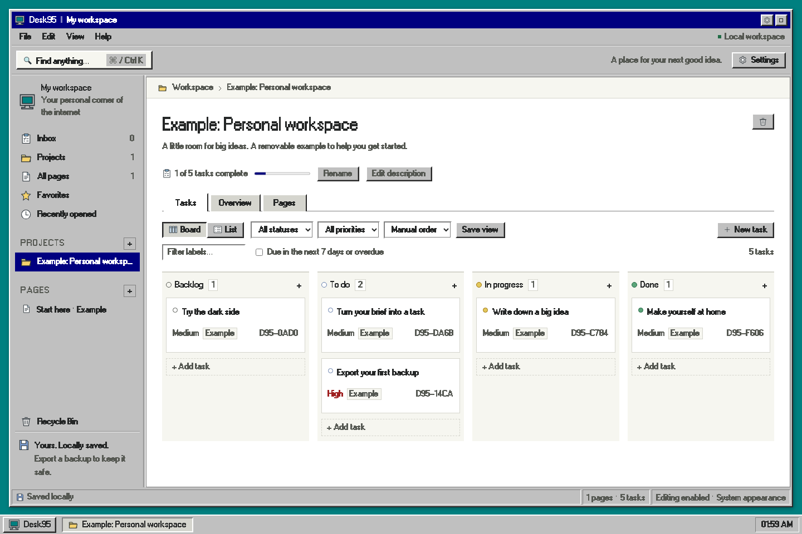

# Desk95

A local Windows 95 workspace for documents, projects, and tasks. React + TypeScript + Tiptap + Dexie. No account, cloud backend, analytics, or external runtime assets.



## macOS app

Download the signed macOS app from [GitHub Releases](https://github.com/Kian-hdr/desk95/releases). It preserves this interface and font, works directly from bundled files with no server, and uses its own app-owned data store. See [macOS launch, migration, build, and distribution notes](MACOS.md). Browser and Mac changes are separate after migration.

## Browser launch

Double-click `Launch.command`, or run:

```sh
npm ci
npm run build
npm start
```

Open **http://127.0.0.1:9595**. Keep the launcher terminal open while serving. Stop it with Control-C. The server binds to this machine only. Use this exact address and port: browser storage is scoped to the origin and browser profile. `localhost` and `127.0.0.1` have separate data.

Node.js 22.12+ is required by the current Vite toolchain; developed and tested with Node 26. Use the locked dependencies via `npm ci`. For development, stop the production server, then run `npm run dev` at the same address. Use `npm run build` after source changes; the local launcher serves the existing production build.

## Everyday use

- File menu: create pages, projects, tasks; export or import workspace backups.
- Pages: nested organization, title/project/parent controls, rich text toolbar, slash commands, attachments, favorites, duplication, history, Markdown export, Trash.
- Select document text and use **Create linked task** to connect writing to action.
- Project tasks have Board and List views, filters, saved view, priorities, dates, labels, and subtasks. Drag a task onto another card to insert before it, or onto a column to append. Status can also be changed in task details without dragging.
- Search/commands: Command-K on macOS or Control-K elsewhere. Command/Control-S retries pending saves. Escape closes dialogs and task details.
- Settings: System (default), Light, or Dark. The system setting follows live appearance changes.
- Additional tabs are read-only until they take over editing. Pending content in an old tab remains in memory and can be exported as a recovery JSON if its save is rejected.

## Save and recovery

“Saved locally” means the browser database write completed, not that an external backup exists. Clearing browser site data, using a private session, or deleting a browser profile can remove this data. Export ZIP backups regularly to a safe location. Request persistent storage in Settings where the browser supports it; a browser may decline.

A full ZIP backup contains versioned `workspace.json`, records, revisions, preferences, and original attachments. Import validates records and files before a database transaction; malformed input leaves the current workspace untouched. Import as a separate workspace is the default safe choice. Replacement is explicit and offers backup export first. Import currently limits ZIP input and declared attachments to 200 MB, and the manifest to 30 MB. Full ZIP backup is lossless; Markdown exports do not embed attachment files.

Deleted items remain in **Recycle Bin** until emptied. Page history retains up to 20 checkpoints, ordinarily no more than once per minute, with extra checkpoints before destructive changes. Restore a prior checkpoint from the page's History button. Emptying the bin is permanent within the app; export a backup first.

If saving fails, keep the tab open, use **Retry saves**, or **Export recovery** to download pending document edits and failed property changes. Property changes pause further edits until retry succeeds. Do not close a tab with unsaved work. The recovery JSON is an emergency content record, not a workspace ZIP: retain it and copy the `documents` content/text back into the matching page after resolving storage. The `operations` array retains failed property patches with method names and arguments for manual recovery. The application warns before leaving with pending document edits.

After one successful production load, the service worker caches the app for offline reloads. Browser data remains local. A new build offers **Save and update**; it waits for pending content to save before refreshing. Offline availability is specific to the browser profile and origin.

## Verification

```sh
npm test
npm run build
npx playwright install chromium
npm start
# In a second terminal:
npm run test:browser
```

Unit tests cover storage behavior, migration, validation, ownership, and backup relationships. Browser tests exercise editing/reload, live appearance, linked tasks, task views, history, attachments, takeover, write failure, offline reload, and narrow-screen navigation. Reports are in `playwright-report/` and `test-results/`.

## Boundaries

Single user, local browser storage. No collaboration, device sync, account system, arbitrary database builder, plugins, or AI features. Browser storage is not encrypted by this app. Anyone with access to the browser profile may access its workspace. External links open only through explicit navigation; attached HTML/SVG files download rather than execute inside the application.

## Windows 95 typography

Desk95 bundles **W95FA by Alina Sava**, a pixel-style recreation of the Windows 95 MS Sans Serif system font. Font files load locally and remain available offline. The original release supplies regular weight; bold and italic use browser synthesis. Missing characters use local system fallbacks.

Source and license: [FontsArena release](https://fontsarena.com/w95fa-by-alina-sava/), [included attribution](public/fonts/w95fa/README.md), and [SIL Open Font License 1.1](public/fonts/w95fa/OFL.txt). The original WOFF2/WOFF files are unmodified.

## License and privacy

Original Desk95 code is available under the [MIT license](LICENSE). Bundled dependencies retain their own licenses in [third-party notices](THIRD_PARTY_NOTICES.txt); W95FA remains under SIL OFL 1.1. Desk95 is an independent project and is not affiliated with Microsoft.

Desk95 has no account, telemetry, analytics, cloud backend, or automatic sync. Your workspace remains in this device's browser or WebKit store. Backups are ordinary ZIP files and should be protected as private documents. Files are not encrypted by Desk95. External links open in your browser when selected.

Report reproducible bugs through [GitHub Issues](https://github.com/Kian-hdr/desk95/issues). Remove private workspace data from screenshots and example backups before sharing.
